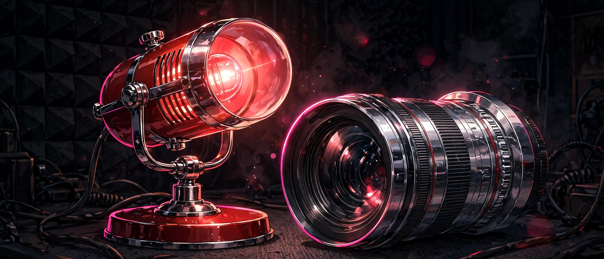

# Redlight

## 18+ — Adults Only

This game contains adult content. It is intended only for players 18 and older. You confirm 18+ at the gate before play begins.

### Content notes

- Exhibitionism: Lux performs in a studio while a camera lens watches, and being seen is the point of the session
- Audience attention is the score — applause, camera flashes, and compliments arrive from the room and she answers each one aloud
- Her level of revelation deepens across the session, and every session closes with a written record of it

All characters depicted are adults.

## A performance game where you pose for the camera, answer its flashes, and keep the audience's attention high enough to go on record.

<a href="https://github.com/NTRanch/redlight">GitHub</a> · <a href="https://github.com/NTRanch/redlight/blob/main/LICENSE.md">License</a> · <a href="https://ntranch.itch.io">itch.io studio page</a> · <a href="https://github.com/NTRanch/redlight/releases/tag/v1.0.0">Release</a>

## Built with

  

## What you do

Lux is performing in her studio, and the camera is watching. You pose to gain attention, and you answer a camera flash before its ring closes for a bigger reward. Attention is always decaying, so the session is a balance: pose, respond, and stay ahead of the decay.

The room fires events on its own schedule — applause feeds attention, compliments raise the floor so decay can never pull you below it, and every event draws a spoken line from Lux, never the same line twice in a row in its kind. End the session above the attention target and the session goes on record, closed by a written summary.

## Features

- Three audience sizes of rising pressure: Solo Record (just the lens), Live Small (a small room), and Live Full (the full room, fastest events), each with faster attention decay and a higher target
- A reactive line set that answers applause, flashes, and compliments — praise raises the floor that decay cannot cross
- Pick your audience before you start, and end above target to put the session on record

## Media

- [Level 1 preview](../docs/previews/level-1-redlight.mp4)
- [Level 2 preview](../docs/previews/level-2-redlight.mp4)
- [Level 3 preview](../docs/previews/level-3-redlight.mp4)

## Controls

| Action | Keys |
| --- | --- |
| Pose (gain attention) | Tap or Space |
| Answer a flash before its ring closes | Enter |
| Pick an audience on the start screen | Left / Right arrows |
| Menus | Up / Down arrows |
| Pause | P or Esc |
| Back | Backspace |

## Status

**v1.0.0** — complete. Built for the Torogao Jam Program (a 14-week, one-game-per-week programme) for the Gameotron jam on itch.io. This GitHub page is the game's home while itch project slots are unavailable. To play, open `web/index.html` in a browser — it is one self-contained file and runs offline. Free to play.

## Credits

A Nice Thoughts Ranch game.

Made with C# and Unity.
